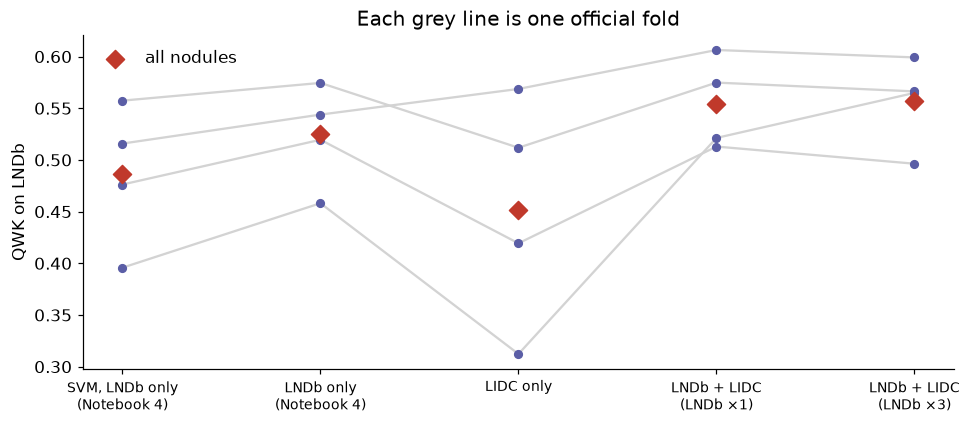

# Lung nodule malignancy on CT — an automatic "second reader"

**Bernardo Ramos** · BSc Artificial Intelligence & Data Science, University of Porto (FCUP) · 2026

Given a chest CT scan and the position of a lung nodule, the model rates how suspicious the nodule
is — **malignancy 1 (highly unlikely) to 5 (highly suspicious)** — fully automatically, from the image
alone. Built for the *Lab IA & CD* course competition on the LNDb dataset.

**Highlights**

- **Agrees with the radiologists' consensus better than two radiologists agree with each other**:
  quadratic weighted kappa 0.55 (cross-validation) and **0.57 on the hidden competition test set**,
  vs **0.53** between radiologists.
- End-to-end pipeline: automatic 3D nodule segmentation → 1136 radiomic features → leakage-free
  statistical feature selection → ordinal regression committee (KNN + SVR + MLP).
- Trained on two datasets (LNDb, Portugal + LIDC-IDRI, USA), with an analysis of the domain shift between them.
- Honest evaluation: official folds, bootstrap confidence intervals, error analysis, robustness checks,
  and a record of what did **not** work and why.



*Adding LIDC-IDRI nodules to the LNDb training data raises the agreement with the radiologists
(QWK on LNDb; each grey line is one official fold, red = all nodules).*

---

## Results (out-of-fold, the 4 official LNDb folds)

| Model | Balanced acc. | Macro F1 | QWK | MAE |
|---|---|---|---|---|
| Size alone (baseline) | 0.32 | 0.32 | 0.32 | 0.89 |
| SVM classifier, LNDb only | 0.46 | 0.41 | 0.49 | 0.75 |
| Score committee, LNDb only | 0.38 | 0.38 | 0.53 | 0.69 |
| Score committee, LIDC only | 0.39 | 0.39 | 0.45 | 0.74 |
| **Score committee, LNDb + LIDC (final)** | **0.42** | **0.42** | **0.55** | **0.67** |
| *Radiologist vs radiologist* | *0.45* | *0.41* | *0.53* | *0.79* |

Competition leaderboard (hidden LNDb test set): **QWK 0.570 · MAE 0.545 · balanced acc. 0.454 · macro F1 0.454**.

---

## How it works

```
CT + nodule position
   └─► 48 mm crop ─► automatic 3D segmentation (adaptive threshold + morphology, Dice 0.68 vs radiologists)
         └─► 1136 features (pyradiomics on original, wavelet and LoG images + 6 composition features)
               └─► feature selection inside each CV fold (Kruskal–Wallis + FDR, Spearman redundancy)
                     └─► KNN + SVR + MLP regress the radiologists' average rating
                           └─► averaged score ─► cut-offs that match the radiologists' class proportions ─► class 1–5
```

**Why a regression committee?** Malignancy is an *ordered* scale and the label is the average of up to
three radiologists. Regressing that average and cutting it into classes respects the order (a 5 read as 4
is a smaller error than a 5 read as 1), which is what QWK and MAE reward.

---

## Notebooks

| Notebook | What it covers |
|---|---|
| `notebook1_data_understanding` | LNDb: the malignancy target, data quality checks, radiologist agreement, every data issue found |
| `notebook2_feature_extraction` | Automatic segmentation (validated against radiologist masks) + 1136 features per nodule |
| `notebook3_feature_selection` | Relevance and redundancy of the features, leakage-free selection, stability |
| `notebook4_malignancy_models` | KNN, SVM, MLP and the score committee; errors, interpretability, robustness |
| `notebook5_lidc` | LIDC-IDRI: labels, agreement, the same features, domain shift vs LNDb |
| `notebook6_final_model` | LNDb only vs LIDC only vs both → final model, competition history |
| `notebook7_2d_vs_3d` | Design check: 2D (largest slice) vs 3D (whole nodule) features |
| `notebookA_texture_appendix` | Appendix: the nodule-texture model (the project's first target) |

Python modules: `lndb_utils.py` (paths, labels, plotting) · `lndb_features.py` (segmentation, features) ·
`lndb_selection.py` (feature selector as a scikit-learn step) · `lndb_models.py` (pipelines, committee) ·
`lidc_data.py` (LIDC-IDRI annotations via `pylidc`) · `download_lidc.py` (downloads only the scans needed).

---

## Reproduce

1. Environment: see `SETUP.md` (conda, Python 3.11).
2. Data (not included — see below): LNDb v4 from Zenodo (doi:10.5281/zenodo.8348419) and
   LIDC-IDRI via `python download_lidc.py --max-gb 30`.
   Place LNDb inside the repository folder as:
   ```
   data/data0 … data5/      training CTs (LNDb-XXXX.mhd + .raw)
   masks/                   radiologist masks
   testdata0/, testdata1/   test CTs
   trainset_csv/            trainNodules.csv, trainNodules_gt.csv, trainFolds.csv, trainCTs.csv,
                            trainFleischner.csv, chars_trainNodules.csv, allNods.csv, LNDbAcqParams.csv
   testset_csv/             testNodules.csv
   ```
3. Run the notebooks in order (1 → 6; 7 and A optional) with *Restart & Run All*.
   All randomness is seeded (`RANDOM_STATE = 42`).

## Data and licences

**No CT scans, masks or derived feature tables are included in this repository.**

- **LNDb** — CC BY-NC-ND 4.0. J. Pedrosa et al., *LNDb: A Lung Nodule Database on Computed Tomography*, arXiv:1911.08434, 2019.
- **LIDC-IDRI** — CC BY 3.0. S. G. Armato III et al., *Medical Physics* 38(2):915–931, 2011; TCIA doi:10.7937/K9/TCIA.2015.LO9QL9SX.

Code: MIT licence (`LICENSE`).

## Limitations

Malignancy is a radiologist's *suspicion*, not a biopsy-confirmed diagnosis · radiologists agree only
moderately (QWK ≈ 0.53) · few nodules rated 4–5 · one hospital for the target population · test-set
masks are automatic · a research project, not a medical device.
